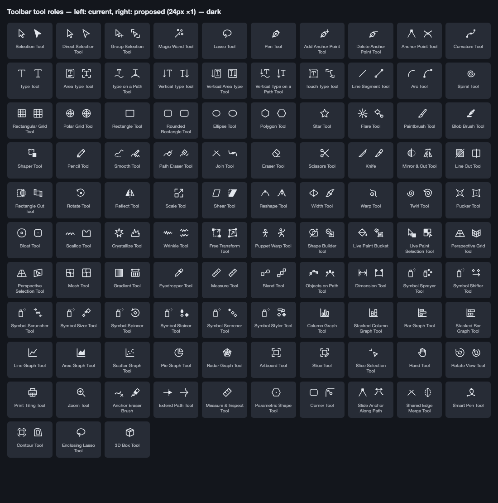
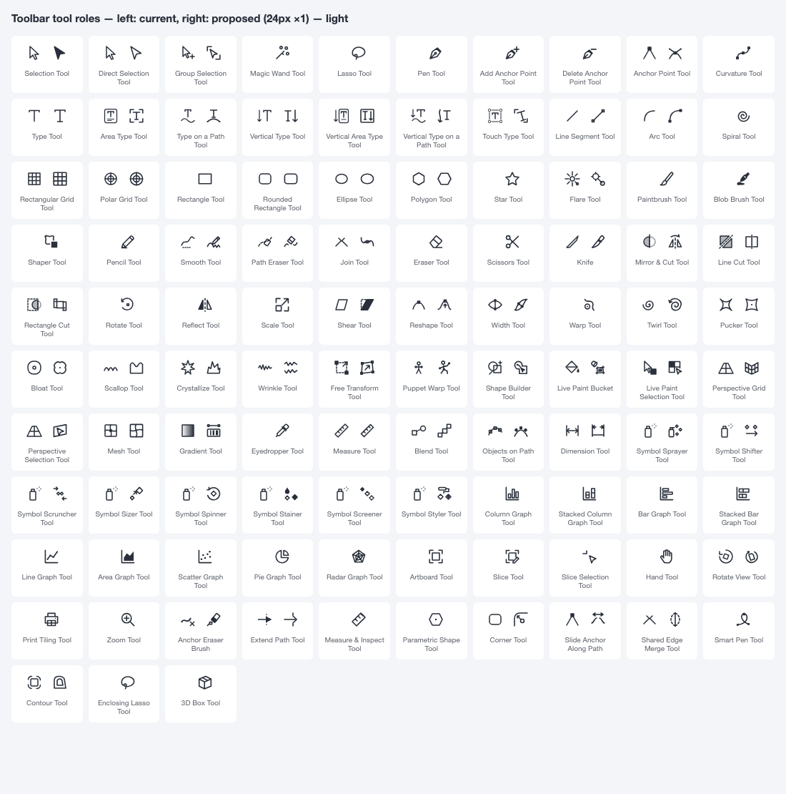
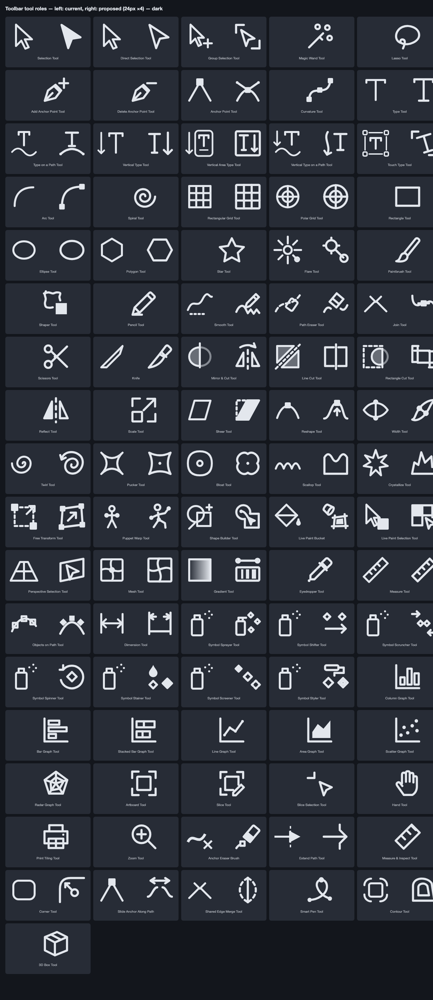
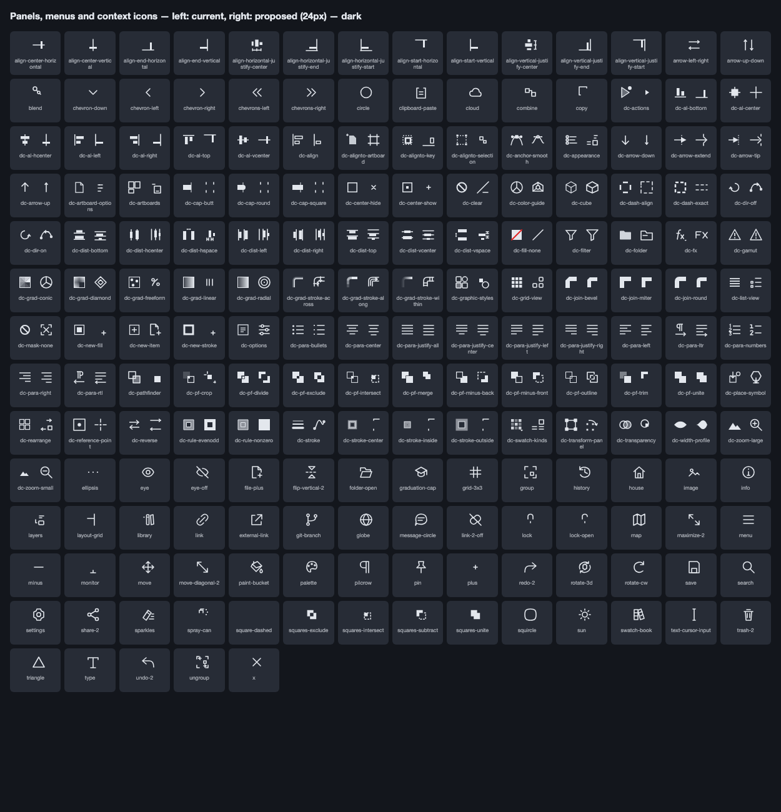
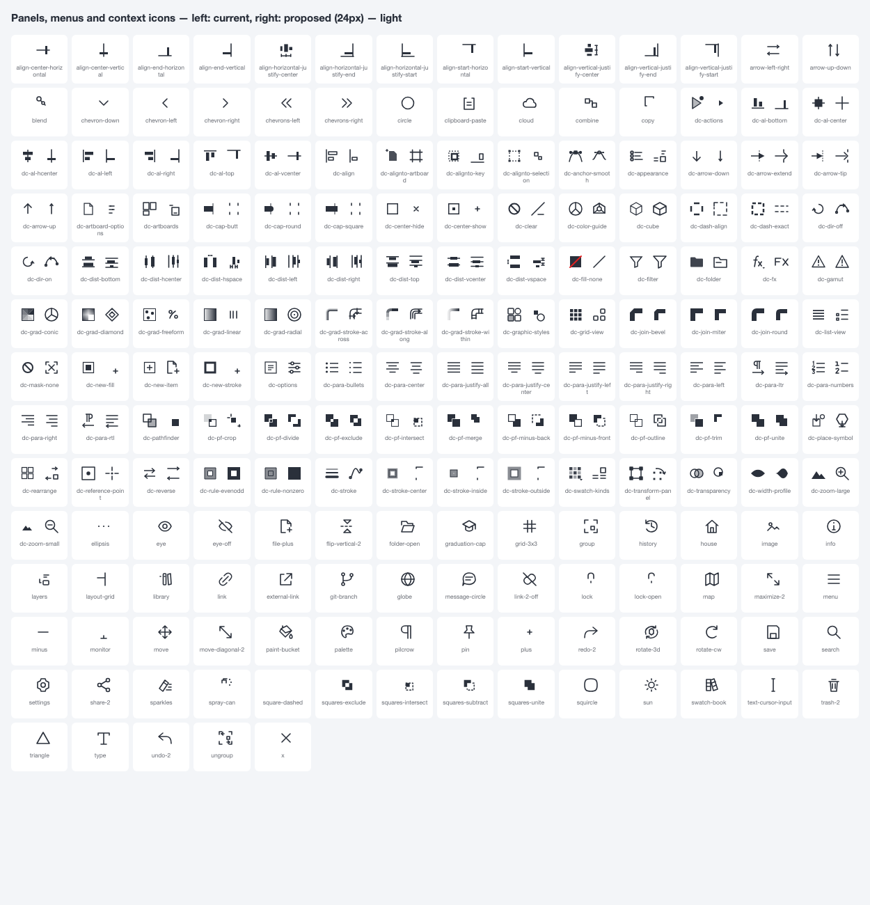
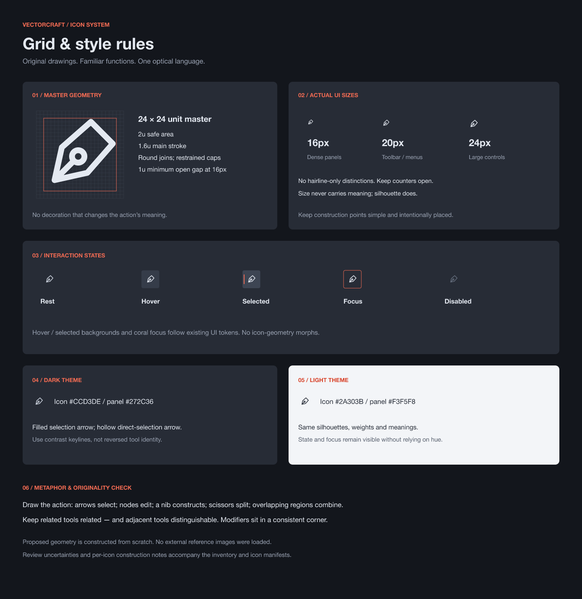

# VectorCraft icon proposal

An original, consistent icon set for [VectorCraft](https://github.com/storytold/vectorcraft): toolbar, panels, menus and cursors, using the conventions designers already know. Design only: no application code and no pull request yet. This repository is the material for discussing the proposal.

**555 entries / 547 distinct SVG drawings:** 115 toolbar, 276 panel, 61 menu and context, 103 cursor and handle variants.

**How it ships:** the new icons come as part of the opt-in *Quiet* colour scheme ([storytold/vectorcraft#3848](https://github.com/storytold/vectorcraft/pull/3848)), so the default look doesn't change. Tracking issue: [storytold/vectorcraft#7820](https://github.com/storytold/vectorcraft/issues/7820).

## How to view

- **In the browser:** open the PNGs in [`boards/`](boards/). Start with the before/after boards below, then the contact sheets of the proposed set (`approved-*-48px-dark.png` and `-light.png`).
- **The drawings:** one SVG per icon in [`svg/`](svg/), named by icon id. [`manifest.json`](manifest.json) maps each id to its category, role, construction note and revision. GitHub renders SVGs directly; open any file in the folder.
- **Editing:** [`figcraft/`](figcraft/) holds the proposed set as a FigCraft document (the style-rules page plus one page per category, all vector).
- **Details:** [`inventory.md`](inventory.md) (every icon: role, where it is used, shortcut, equivalent, verdict), [`style-rules.md`](style-rules.md), [`originality-register.md`](originality-register.md), and machine-readable data in [`data/`](data/).

## Before and after

Left is the current icon, right is the proposed one, at real size (24 px).

**Toolbar, dark**

**Toolbar, light**

**Toolbar at 4x (96 px), dark**

**Panels and menus, dark**

**Panels and menus, light**

## Problem

- **Switchers don't recognise the tools.** People coming from other vector editors rely on visual memory: an arrow for selection, a hollow arrow for direct selection, a pen nib, a "T", a bucket. Several VectorCraft icons break that memory or draw a different idea.
- **Some icons say the wrong thing.** In the inventory, 26 records are marked "wrong metaphor" and 409 "redraw" (543 records: 273 registered SVGs, 103 tool roles, 96 cursor roles, plus controls, fonts and identity assets). Examples: one column-chart symbol is reused for nine graph tools; one symbol-sprayer icon for eight symbol tools; the Tabs panel uses a generic justify glyph; several tools fall back to a dashed square because no icon is registered (`box3d`, ellipse slice and chord modes).
- **The set is not one family.** Most icons are third-party Lucide glyphs (ISC) and a `dc-*` set of 159 files; strokes, corner treatment and filled/outline use differ.

## Approach

An original set, drawn from scratch for VectorCraft, following the metaphors that several design apps share (Figma, Affinity Designer, Inkscape, Sketch, Krita/GIMP and others), in our own lines. Common ideas, not anyone's artwork.

- One grid: 24×24 viewBox, 2-unit optical inset, 1.6 stroke, round caps and joins, solid fills only for emphasis. Legible at 16, 20 and 24 px, on dark and light themes.
- One concept per function. Where the app has several tools that shared one icon, each gets its own.
- No tracing, no copying, no icon fonts or screenshots as sources. Each drawing has a written construction note and a note on how it differs from the equivalent icon in other apps.
- Reviewed icon by icon in three rounds; this is the final draft from my side, pending maintainer feedback.

## The proposed set

| Category | Drawings | Dark | Light |
|---|---|---|---|
| Toolbar | 115 | [sheet](boards/approved-toolbar-48px-dark.png) | [sheet](boards/approved-toolbar-48px-light.png) |
| Panels | 276 | [sheet](boards/approved-panels-48px-dark.png) | [sheet](boards/approved-panels-48px-light.png) |
| Menus and context | 61 | [sheet](boards/approved-menus-context-48px-dark.png) | [sheet](boards/approved-menus-context-48px-light.png) |
| Cursors and handles | 103 | [sheet](boards/approved-cursors-48px-dark.png) | [sheet](boards/approved-cursors-48px-light.png) |

`CHECKSUMS.txt` lists the SHA-256 of every file in `svg/` and of the data files.

## Scope

In: replacing the SVGs behind the icon table (`assets/icons`, `icon_data.rs`, the tool-name alias map in `icons.rs`), the new roles above, and the cursor artwork. Out: the app icon, file-type icons, fonts, and any layout or behaviour change.

## Plan: small PRs by area

1. **Quiet icon-set lookup:** an icon set keyed by the active colour scheme (default: today's icons; Quiet: the new ones), falling back to the current icon when a new one is missing, plus the alias-map changes for roles that gain their own icon (`box3d`, graph and symbol variants, ellipse modes) and an `ASSETS.md` row per file. The default scheme renders exactly what it renders today.
2. **Toolbar** (103 tool roles): switch the map; before/after screenshots at real size.
3. **Panels** (Align, Pathfinder, Transform, Appearance, Layers, …): one or two PRs.
4. **Menus and context actions.**
5. **Cursors and handles:** the cursor catalogue and the procedurally painted handles.
6. Only if Quiet later becomes the default: remove the replaced Lucide/`dc-*` files and their notices once nothing references them.

Each PR is reviewable on its own and can be reverted without the others. The `cargo xtask assets` check enforces the provenance table at every step.

## Open questions

- One tracking issue with the plan above, or discuss first?
- Preferred size per PR (the toolbar alone is 103 icons).
- Any role you would rather keep as it is today.

## Licence

The drawings are original work by the contributor, offered under the repository's licence: [MIT](LICENSE-MIT) OR [Apache-2.0](LICENSE-APACHE), at your option. Third-party icons that remain in VectorCraft until they are replaced keep their notices (`assets/icons/LICENSE-lucide.txt` there). No third-party artwork was copied or traced for the new set.
